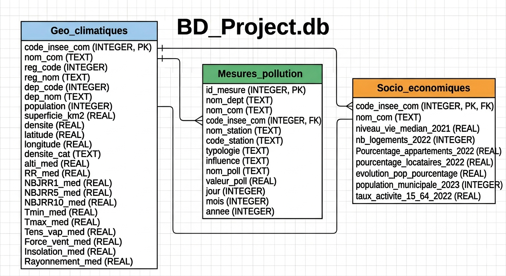
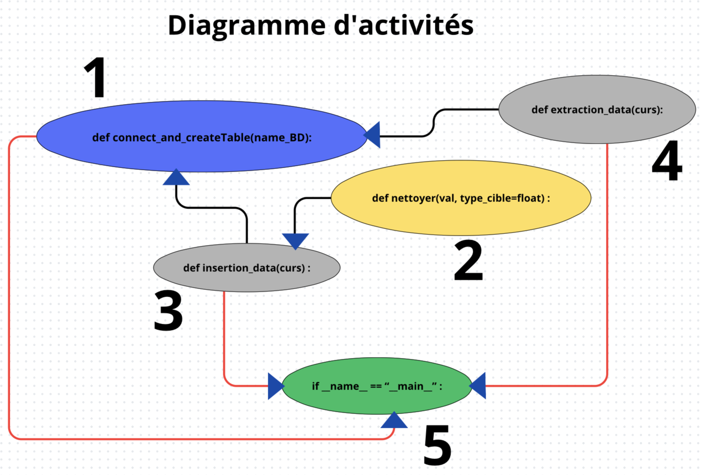

# Pipeline de données : qualité de l'air en Occitanie

Projet universitaire (Licence MIASHS, UE Info-Stat, avril 2026) réalisé en équipe de quatre.

À partir de trois fichiers CSV bruts (mesures de pollution, données géo-climatiques et données socio-économiques), le projet construit une **base de données relationnelle SQLite**, en extrait des jeux de données ciblés avec **SQL**, puis les analyse sous **R** pour répondre à cinq problématiques sur la qualité de l'air.

```
CSV bruts ──► nettoyage (Python) ──► base SQLite ──► requêtes SQL ──► CSV ciblés ──► analyse statistique (R)
```

## En chiffres

| | |
|---|---|
| Mesures de pollution chargées | **231 843** (mesures journalières, 2022 à 2026) |
| Stations de mesure | 59 |
| Polluants suivis | 8 (NO2, NOX, NO, O3, PM10, PM2.5, SO2, H2S) |
| Communes de référence | 34 935 |
| Temps d'exécution du pipeline | environ 4 secondes |

## Architecture de la base



- **`Geo_climatiques`** : table de référence, une ligne par commune (clé primaire `code_insee_com`).
- **`Socio_economiques`** : indicateurs socio-économiques, liés à la commune par clé étrangère.
- **`Mesures_pollution`** : mesures journalières des stations, avec une clé primaire technique (`id_mesure`) et une clé étrangère vers la commune.

Choix techniques :
- **Intégrité référentielle** : clés étrangères activées (`PRAGMA foreign_keys = ON`) et filtrage préalable des codes INSEE, pour qu'aucune mesure ne pointe vers une commune inexistante.
- **Typage strict** (`REAL`, `INTEGER`) pour éviter les erreurs de format à l'import dans R.
- **Base reconstruite à chaque exécution**, pour toujours travailler sur des données propres.
- **Commit unique après l'insertion** : les données ne sont enregistrées que si tout le chargement réussit.

## Organisation du code



| Fichier | Rôle |
|---|---|
| `index.py` | Programme principal : enchaîne création, insertion et extraction |
| `connect.py` | Connexion à SQLite et création des trois tables |
| `clear.py` | Nettoyage des valeurs : guillemets, virgules décimales, valeurs manquantes (`NA`, `N/A`, « résultat non disponible ») |
| `insert.py` | Lecture des CSV et insertion en lot (`executemany`) |
| `extract.py` | Cinq requêtes SQL (jointures, agrégations) exportées en CSV |
| `rapport/Rapport_G15.Rmd` | Analyse statistique et rapport sous R Markdown |

## Les cinq problématiques

1. Dans quelle mesure les caractéristiques géographiques, climatiques et socio-économiques influencent-elles la qualité de l'air dans les communes d'Occitanie ?
2. La densité de population et la proportion d'appartements aggravent-elles la pollution au NO2 ?
3. Les niveaux de pollution résultent-ils davantage des caractéristiques naturelles ou de l'intensité des activités humaines ?
4. Les conditions climatiques modèrent-elles l'exposition à la pollution selon le type de station ?
5. Comment la pollution varie-t-elle mois par mois en 2023 ?

**Conclusion principale** : la qualité de l'air est fortement liée aux activités humaines. Les zones les plus urbanisées présentent des niveaux de pollution plus élevés, ce qui pointe vers le trafic routier comme levier d'action prioritaire.

## Lancer le projet

Prérequis : Python 3 (bibliothèque standard uniquement) et R / RStudio pour le rapport.

```bash
# placer les trois fichiers CSV bruts à la racine du projet, puis :
python3 index.py
```

Le script crée `BD_Project.db` et génère les cinq fichiers `P1_…csv` à `P5_…csv`. Le rapport (`rapport/Rapport_G15.Rmd`) se compile ensuite dans RStudio avec « Knit ». Les fichiers d'extraction déjà générés sont fournis dans `rapport/data/`.

> Les fichiers CSV bruts ne sont pas inclus dans ce dépôt (fournis dans le cadre du cours). Fichiers attendus : `mesures_occitanie_journaliere_pollution.csv`, `donnees_geo_climatiques.csv`, `donnees_socio_economiques.csv`.

## Outils

Python · SQLite · SQL · R / RStudio · R Markdown

## Équipe

Ousmane Barry, Mamadou Fall, Khady Mbengue, Safiatou Sy (Université Toulouse Jean Jaurès).
