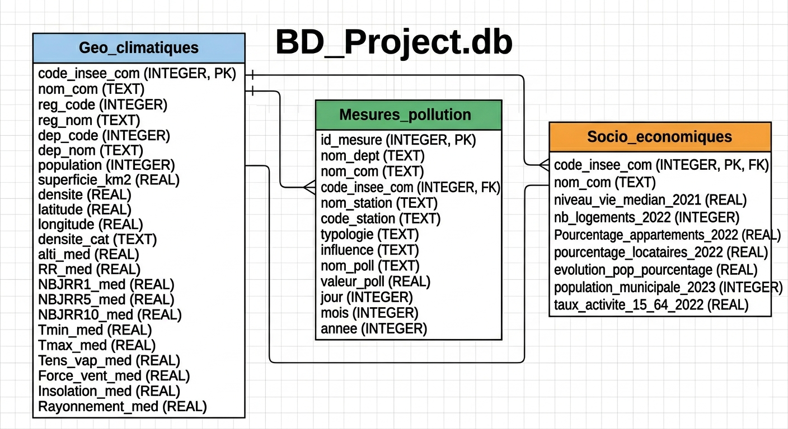

<link href="https://fonts.googleapis.com/css2?family=Liberation+Serif:wght@400;700&display=swap" rel="stylesheet">
<style>
body {
  font-family: 'Liberation Serif', serif;
  font-size: 16px;
  
</style>

<style type="text/css">
}
/* ── Corps ── */
body, td {
  font-size: 16px;
  line-height: 1.75;
  color: #2d2d2d;
  font-family: "Segoe UI", Arial, sans-serif;
}
/* ── Code ── */
code.r { font-size: 14px; }
pre {
  font-size: 13px;
  background-color: #f4f7fb;
  border-left: 4px solid #2c7fb8;
  padding: 12px 16px;
  border-radius: 3px;
}
.boite-intro {
  background-color: #eef4fb;
  border-left: 5px solid #2c7fb8;
  padding: 14px 20px;
  margin: 18px 0;
  border-radius: 4px;
}
.boite-info {
  background-color: #f0f9f0;
  border-left: 5px solid #27ae60;
  padding: 12px 18px;
  margin: 14px 0;
  border-radius: 4px;
}
.boite-requete {
  background-color: #fdf6ec;
  border-left: 5px solid #e67e22;
  padding: 12px 18px;
  margin: 14px 0;
  border-radius: 4px;
}
.boite-synthese {
  background-color: #f5f0fa;
  border-left: 5px solid #8e44ad;
  padding: 12px 18px;
  margin: 14px 0;
  border-radius: 4px;
}
/* ── Tableau ── */
table {
  border-collapse: collapse;
  width: 100%;
  font-size: 14px;
}
th {
  background-color: #2c7fb8;
  color: white;
  padding: 8px 12px;
}
td { padding: 6px 12px; border-bottom: 1px solid #ddd; }
tr:nth-child(even) { background-color: #f5f9ff; }
</style>


```{r setup, include=FALSE}
knitr::opts_chunk$set(
  echo    = TRUE,
  warning = FALSE,
  message = FALSE,
  fig.align = "center",
  fig.width  = 10,
  fig.height = 6
)
```
# **<u>Introduction</u>**

Ce projet Info-Stat porte sur l’analyse de données liées à la qualité de l’air en Occitanie. L’objectif est de comprendre et exploiter ces données à l’aide d’outils informatiques et statistiques.

Pour cela, nous avons d’abord organisé les données brutes (fichiers CSV) dans une base de données SQLite afin de les structurer correctement. Ensuite, nous avons utilisé RStudio pour nettoyer, analyser et interpréter les données.

Ce projet permet donc de mettre en pratique plusieurs compétences : gestion de base de données, traitement de données et analyse statistique.

# **<u>Base de données</u>**
**<u>PRESENTATION DE LA BASE DE DONNÉES</u> :**

Dans le cadre de ce projet tutoré, nous étudions et analysons la qualité de l'air en Occitanie.

Afin d'aboutir à des analyses concrètes et pertinentes à partir des données initiales au format CSV, nous avons mis en place une base de données relationnelle nommée DB_Project.db (SQLite). Ce processus a permis d'importer et de structurer les données pour faciliter l'extraction de fichiers ciblés, répondant à nos différentes problématiques, avant de procéder à leur analyse statistique sur RStudio.



## **<u>Construction de la base de données</u>**
Pour construire BD_Project.db, nous avons structuré le code en 5 étapes clés. Cette modularité permet de séparer la connexion & création des tables, l'insertion et l'extraction des données.

- **DIAGRAMME D'ACTIVITÉS**


Ici, les flèches rouges représentent les fonctions directement appelées par la fonction principale **main**.
Les flèches noires sont un peu comme des passerelles.

La fonction **nettoyer** permet de nettoyer les données avant leur insertion.
La fonction **insertion_data** utilise les tables déjà créées avec succès par la fonction **connect_and_createTable(name_BD)** pour effectuer l’insertion.

Une fois l’insertion réussie sans ambiguïté, la fonction **extraction_data** utilise les tables déjà remplies dans la base créée afin d’extraire les données.

D’où les flèches noires.

### **<u>EXPLICATIONS + JUSTIFICATIONS DES CHOIX LIÉS À LA BDD</u>**

Nous avons opté pour une architecture relationnelle afin de garantir la cohérence des informations :

a. **Clés Primaires (PK) et Étrangères (FK) :** L'utilisation du code_insee_com comme pivot central permet de lier les données climatiques, socio-économiques et les mesures de pollution. Cela évite les doublons et assure qu'une mesure de pollution est toujours rattachée à une commune existante.

Nous avons imposé des types SQL précis (REAL pour les mesures, INTEGER pour la population) afin d'éviter toute erreur de format lors de l'importation finale sous R.

b. **Modularité :** Le découpage en fonctions évite la redondance et facilite le débogage.

c. **Nettoyage Automatisé :** Le script réinitialise la base à chaque exécution (os.remove), garantissant des analyses sur des données "propres".

d. **Sécurité (Commit) :** L'usage de db.commit() assure que les données ne sont enregistrées que si l'intégralité de l'insertion réussit.

e. **PRAGMA foreign_keys = ON :** Cette fonctiion sqlite nous a permis à activer les clés étrangères car après un `run`de notre code, on avait des erreurs de contrainte d'integrigté concernanant les clés. 

*Aide : Documention SQlite*

**Source :** `https://sqlite.org/foreignkeys.html`

Comme ça, plutôt que de charger des fichiers massifs dans RStudio, nous utilisons SQL pour extraire uniquement les variables nécessaires via des fichiers CSV ciblés. Cette méthode optimise la mémoire vive et clarifie la lecture des graphiques.

1. Le fichier **<u>connect.py</u>** sert à créer la connexion de ba base de données '*BD_Project.db*' et la création des tables.
```
# FONCTION de connexion et création des tables
 def connect_and_createTable(name_BD):
    if os.path.exists(name_BD):
        os.remove(name_BD)
        print(f"Ancienne base {name_BD} supprimée pour remise à zéro.")

    db = sqlite3.connect(name_BD)
    curs = db.cursor()

    curs.execute("PRAGMA foreign_keys = ON;")

    # TABLE 1 : GEO_CLIMATIQUES (code_insee_com INTEGER PRIMARY KEY)
    curs.execute("""
    CREATE TABLE IF NOT EXISTS Geo_climatiques (
        code_insee_com INTEGER PRIMARY KEY, nom_com TEXT, 
        reg_code INTEGER, reg_nom TEXT, 
        dep_code INTEGER, dep_nom TEXT, 
        population INTEGER, superficie_km2 REAL, densite REAL,         
        latitude REAL, longitude REAL, densite_cat TEXT, 
        alti_med REAL, RR_med REAL,                  
        NBJRR1_med REAL, NBJRR5_med REAL,     
        NBJRR10_med REAL, Tmin_med REAL, Tmax_med REAL, 
        Tens_vap_med REAL, Force_vent_med REAL, Insolation_med REAL, Rayonnement_med REAL);
    """)
    ....
      ....
        ....
```

2. Le fichier **<u>clear.py</u>** quand à lui, sert à nettoyer les variables en en remplaçant toutes les valeurs **["", "NA", "N/A", "N/A - RÉSULTAT NON DISPONIBLE", "RESULTAT NON DISPONIBLE"]** à null et toutes les **(,)** par un point **(.)**, afin d’assurer une lisibilité très correcte et sans ambiguïté.

```
# FONCTION de nettoyage
  def nettoyer(val, type_cible=float):
    if val is None: 
        return None
    val = str(val).strip().replace('"', '').replace(',', '.')
   
    textes_na = ["", "NA", "N/A", "N/A - RÉSULTAT NON DISPONIBLE", "RESULTAT NON DISPONIBLE"]
    if val.upper() in textes_na:
        return None
    try:
        return type_cible(float(val))
    except (ValueError, TypeError):
        return None
```

3. Le fichier **<u>insert.py</u>** sert à insérer les données dans les tables déjà créées.
Comme les fichiers CSV contenaient initialement des valeurs non compréhensibles telles que ["", "NA", "N/A", "N/A - RÉSULTAT NON DISPONIBLE", "RESULTAT NON DISPONIBLE"], il a fallu les nettoyer afin de garantir une insertion propre et lisible.
Ainsi, cette fonction de nettoyage a été appliquée à chaque variable n’étant pas de type **text**.

```
# FONCTION d'insertion
from clear import nettoyer # Import du fichier clear pour nettoyer les variables
# INSERTION DES DONNÉES
  def insertion_data(curs):
      data1 = []
      with open('donnees_geo_climatiques.csv', mode='r', encoding='utf-8') as geo:
          reader = csv.DictReader(geo)
          for r in reader:
              data1.append((
                  nettoyer(r["code_insee_com"], int), r["nom_com"],
                  nettoyer(r["reg_code"], int), r["reg_nom"],
                  nettoyer(r["dep_code"], int), r["dep_nom"],nettoyer(r["population"], int), 
                  nettoyer(r["superficie_km2"]), nettoyer(r["densite"]), 
                  nettoyer(r["latitude"]), nnettoyer(r["longitude"]), r["densite_cat"],
                  nettoyer(r["alti_med"]), nettoyer(r["RR_med"]),nettoyer(r["NBJRR1_med"]), 
                  nettoyer(r["NBJRR5_med"]), nettoyer(r["NBJRR10_med"]), 
                  nettoyer(r["Tmin_med"]), nettoyer(r["Tmax_med"]), 
                  nettoyer(r["Tens_vap_med"]), nettoyer(r["Force_vent_med"]), 
                  nettoyer(r["Insolation_med"]), nettoyer(r["Rayonnement_med"])))
      curs.executemany("INSERT OR REPLACE INTO Geo_climatiques VALUES       (?,?,?,?,?,?,?,?,?,?,?,?,?,?,?,?,?,?,?,?,?,?,?)", data1)
      
      ....
        ....
          ....
```

4. Le fichier **<u>extract.py</u>** sert à extraire les données de la base de données à l'aide des réquettes **SQL**.
Pour répondre à chaque problématique ou sous-problématique, une réquette était nécessaire pafin d’identifier toutes les variables susceptibles d’y répondre.

```
# FONCTION d'extraction
  def extraction_data(curs):
    # PARTIE Problématique
    '''
        Problématique 1:
        Dans quelle mesure les caractéristiques géographiques et climatiques, ainsi que 
        les indicateurs socio-économiques influencent-ils la qualité de l'air dans les     communes d'Occitanie ?   
    '''
    # Requette pour Problématique 1 
    curs.execute("""
        SELECT 
        Geo_climatiques.nom_com, 
        Geo_climatiques.population, 
        Geo_climatiques.densite,
        Geo_climatiques.Force_vent_med, 
        Socio_economiques.nb_logements_2022,
        Socio_economiques.pourcentage_locataires_2022,
        AVG(Mesures_pollution.valeur_poll) as Moyenne_Mesure_Pollution, 
        Mesures_pollution.influence,
		COUNT(DISTINCT Mesures_pollution.nom_station) AS nb_Stations
    FROM Geo_climatiques
    INNER JOIN Socio_economiques USING(code_insee_com)
    INNER JOIN Mesures_pollution USING(code_insee_com)
    WHERE Mesures_pollution.nom_poll = "NOX" and Geo_climatiques.reg_code = 76
    GROUP BY Geo_climatiques.nom_com, 
    Geo_climatiques.code_insee_com
    ORDER BY Moyenne_Mesure_Pollution DESC;
    """)
    
    tab1 = curs.fetchall()
    with open('P1_analyse_geoClimatique.csv', mode='w', encoding='utf-8', newline='') as prob1:
        writer = csv.writer(prob1)
        
        writer.writerow(['nom_com', 'population', 'densite', 'Force_vent_med', 'nb_logements_2022',
                        'pourcentage_locataires_2022', 'Moyenne_Mesure_Pollution',
                        'influence', 'nb_Stations'])

        writer.writerows(tab1)
        
      ....
        ....
          ....
```

5. Le fichier **<u>index.py</u>** est le fichier dans lequel on a importé toutes les bibliothèques afin d’appeler toutes les fonction définies dans les autres fichiers, sauf la fonction *nettoyer* qui est directement appliquée dans la fonction *insertion_data*.

Ce fichier, dans lequel se trouve la fonction principale main, sert de point d’entrée du programme. C’est-à-dire qu’il relie tous les autres fichiers et, une fois exécuté, toutes les autres fonctions s’exécutent.

**IMPORTATIONS : **

- **from connect import connect_and_createTable**

- **from insert import insertion_data**

- **from extract import extraction_data**

```
# PROGRAMME PRINCIPAL
  if __name__ == "__main__":
      db, curs = connect_and_createTable("BD_Project.db") 
      insertion_data(curs) 
      db.commit()  
                  
      extraction_data(curs) 
  
      # Fermeture du curseur et de la base de donnée
      curs.close()
      db.close()
  
      print("La base de données a été clôturée avec succès !")
```     

## **<u>Extraits de tables depuis la base de données</u>**

La fonction `extraction_data()`, définie dans le fichier `extract.py` et appelée depuis `index.py`, realise **5 extractions** depuis la base de données. Chaque extraction suit le même schéma en trois étapes : exécution d'une requête SQL, récupération des résultats en mémoire, puis écrire dans un fichier CSV. Ces fichiers CSV sont ensuite utilisés pour l'analyse statistique en R.

---

### **<u>Problématique 1 - Influence géographique, climatique et socio-économique sur le NOX</u>**

**Question : **  Dans quelle mesure les caractéristiques géographiques et climatiques, ainsi que les indicateurs socio-économiques influencent-ils la qualité de l'air dans les communes d'Occitanie ? 
        
**Etape 1 - La requête SQL **

**Choix de la conception :** Nous sélectionnons pour chaque commune d'Occitanie (`reg_code = 76`) les variables géographiques (population, densité, force du vent), socio-économiques (nombre de logements, pourcentage de locataires) ainsi que la moyenne des concentrations de NOX et le nombre de stations de mesure distinctes. Le filtre sur `nom_poll ="NOX"` permet de cibler uniquement ce polluant. Le `GROUP BY` sur `nom_com` et `code_insee_com` garantit une ligne unique par commune, et le tri `ORDER BY Moyenne_Mesure_Pollution DESC` place les communes les plus polluées en tête.

```
curs.execute("""
        SELECT 
        Geo_climatiques.nom_com, 
        Geo_climatiques.population, 
        Geo_climatiques.densite,
        Geo_climatiques.Force_vent_med, 
        Socio_economiques.nb_logements_2022,
        Socio_economiques.pourcentage_locataires_2022,
        AVG(Mesures_pollution.valeur_poll) as Moyenne_Mesure_Pollution, 
        Mesures_pollution.influence,
		COUNT(DISTINCT Mesures_pollution.nom_station) AS nb_Stations
    FROM Geo_climatiques
    INNER JOIN Socio_economiques USING(code_insee_com)
    INNER JOIN Mesures_pollution USING(code_insee_com)
    WHERE Mesures_pollution.nom_poll = "NOX" and Geo_climatiques.reg_code = 76
    GROUP BY Geo_climatiques.nom_com, 
    Geo_climatiques.code_insee_com
    ORDER BY Moyenne_Mesure_Pollution DESC;
    """)
```
**Etape 2 - Récupération des resultats**

```
tab1 = curs.fetchall()

```
`fetchall()` récupère l'intégralité des lignes retournées par la requête sous forme de liste de tuples en mémoire. Nous utilisons `fetchall`car nous avons besoin de toutes lignes pour les écrire dans le CSV.

**Etape 3 - Ecriture dans le fichier CSV **

```
with open('P1_analyse_geoClimatique.csv', mode='w', encoding='utf-8', newline='') as prob1:
        writer = csv.writer(prob1)
        writer.writerow(['nom_com', 'population', 'densite', 'Force_vent_med', 'nb_logements_2022',
                        'pourcentage_locataires_2022', 'Moyenne_Mesure_Pollution',
                        'influence', 'nb_Stations'])
        
        
        writer.writerows(tab1)
```
Plusieurs choix techniques sont à justifier ici :

- `mode='w'` : Ouverture en ecriture, ce qui recrée le fichier à chaque exécution pour éviter d'accumuler des données obsolètes
- ` encoding='utf-8'` : Gestion des caractères spéciaux et accents présents dans les noms de communes.
- ` newline=''` : Evite les sauts de ligne doubles sur Windows, confomément à la documentation officielle du module `csv` de Python
- `writer.writerow(..) ` : Ecrit séparément la ligne d'en têtes avec les noms des colonnes
- `writer.writerows(tab1) ` : Ecrit toutes les lignes de données en une seule instruction, plus efficace que d'itérer manuellement

**Résultat - Aperçu de la table extraite**

La table contient **21 Communes ** d'Occitanie et sera utilisée pour l'analyse statistique de la problématique 1.

---

### **<u>Problématique 2 - Densité de population, proportion d’appartements et pollution NO2</u>**

**Question :** Est-ce que la densité de la population et la proportion d'appartements aggravent la pollution au NO2?

**Etape 1 - La requête SQL**

**Choix de conception : ** Nous ciblons ici le polluant NO2, directement lié au trafic routier et à la densité urbaine. Le `Group BY code_insee_com` (plutôt que `nom_com`) garantit une ligne unique par commune en cas de noms identiques. Le tri par densité décroissante facilite l'observation de la relation densité/NO2.

```
curs.execute("""
        SELECT 
        Geo_climatiques.nom_com,
        Geo_climatiques.densite,                     
        Socio_economiques.Pourcentage_appartements_2022, 
        AVG(Mesures_pollution.valeur_poll) AS moy_NO2    
    FROM Geo_climatiques 
    INNER JOIN Socio_economiques 
        ON Geo_climatiques.code_insee_com = Socio_economiques.code_insee_com
    INNER JOIN Mesures_pollution 
        ON Geo_climatiques.code_insee_com = Mesures_pollution.code_insee_com
    WHERE Mesures_pollution.nom_poll = 'NO2' 
    AND Geo_climatiques.reg_nom = 'Occitanie'
    GROUP BY Geo_climatiques.code_insee_com
    ORDER BY Geo_climatiques.densite DESC;
    """)

```

**Etape 2 - Recupération des resultats**

```
 tab2 = curs.fetchall()
 
 ```
 
**Etape 3 - Ecriture dans le fichier CSV **

```
    with open('P2_analyse_densite_population.csv', mode='w', encoding='utf-8', newline='') as prob2:
        writer = csv.writer(prob2)
       
        writer.writerow(['nom_com', 'densite', 'prop_appart', 'moy_no2'])
        
        writer.writerows(tab2)
```

Les mêmes choix techniques s'appliquent sur (`mode='w'`,`'utf-8'`, `newline=''`, `writer.writerows(..)`, `writer.writerow(..)`). Nous avons simplifié les noms des colonnes (`prop_appart`, `moy_no2`) pour faciliter leur utilisation dans R.

**Résultat - Apperçu de la table extraite**

La table contient **22 communes** et sera utilisée pour l'analyse statistique de la problématique 2.

---

### **<u>Problématique 3 - Niveaux de pollution selon la typologie et l'influence des stations</u>**

**Question :** Les niveaux de pollution résultent-ils davantage des caractéristiques naturelles ou de l'intensité des activités humaines ?

**Etape 1 - La requête SQL **

**Choix de la conception : ** Contrairement aux requêts précedentes, nous ne filtrons pas sur un polluant spécifique afin d'obtenir une vue d'ensemble de tous les polluants. Le `Groupement BY` sur quatre variables (`nom_com`, `nom_poll`, `typologie`, `influence`) permet de croiser le type de station ave son environnement et d'obtenir une moyenne représentative pour chaque combinaison.

```
   curs.execute("""
        SELECT
        Mesures_pollution.nom_com,
        Mesures_pollution.typologie,
        Mesures_pollution.influence,
        Mesures_pollution.nom_poll,
        AVG(valeur_poll) AS valeur_moyenne
    FROM mesures_pollution
    INNER JOIN Geo_climatiques USING(code_insee_com)
    INNER JOIN Socio_economiques USING(code_insee_com)
    WHERE Geo_climatiques.reg_nom = 'Occitanie'
    GROUP BY Mesures_pollution.nom_com,  
    Mesures_pollution.nom_poll,  
    Mesures_pollution.typologie, Mesures_pollution.influence
    ORDER BY valeur_moyenne DESC;
    """)
```

**Etape 2 - Récupération des résultats**

```
tab3 = curs.fetchall()

```
**Etape 3 - Ecriture dans le fichier CSV **

```
    with open('P3_analyse_niveaux_de_pollution.csv', mode='w', encoding='utf-8', newline='') as prob3:
        writer = csv.writer(prob3)
        
        writer.writerow(['nom_com', 'typologie', 'influence', 'nom_poll', 'valeur_moyenne'])
        
        writer.writerows(tab3)
```

Les mêmes choix techniques s'appliquent sur (`mode='w'`, `'utf-8'`, `newline=''`, `writer.writerows(..)`, `writer.writerow(..)`).

**Résultat - Apperçu de la table extraite**

La table contient **171 communes** et sera utilisée pour l'analyse statistique de la problématique 3.

---


### **<u>Problématique 4 - Conditions climatiques et pollution selon le type de station</u>**

**Question :** Les conditions climatiques modèrent-elles l'explosition à la pollution selon les types de station ?

**Etape 1 - La requête SQL **

**Choix de la conception : ** Nous croisons ici les variables climatques médianes de chaque commune (température maximale, force du vent, précipitations) avec la pollution moyenne, en distinguant les types de station. Le `Group BY code_insee_com, typologie` produit une ligne par commune et par type de station - ce choix est important car il évite une granularité excessive qui rendrait l'analyse impossible.

```
curs.execute("""
        SELECT 
        Geo_climatiques.nom_com,
        Mesures_pollution.typologie,
        Geo_climatiques.Tmax_med, 
        Geo_climatiques.Force_vent_med,
        Geo_climatiques.RR_med, 
        AVG(Mesures_pollution.valeur_poll) AS pollution_moyenne
    FROM Mesures_pollution
    INNER JOIN Geo_climatiques 
    ON Mesures_pollution.code_insee_com = Geo_climatiques.code_insee_com
    WHERE Geo_climatiques.reg_nom = 'Occitanie'
    GROUP BY Geo_climatiques.code_insee_com, Mesures_pollution.typologie
    ORDER BY Mesures_pollution.typologie;
    """)

```

**Etape 2 - Récupération des resultats**

```
 tab4 = curs.fetchall()
 
 ```
    
**Etape 3 - Ecriture dans le fichier CSV **

```
    with open('P4_analyse_conditions_climatique.csv', mode='w', encoding='utf-8', newline='') as prob4:
        writer = csv.writer(prob4)
        
        writer.writerow(['typologie', 'Tmax_med', 'Force_vent_med', 'RR_med', 'pollution_moyenne'])
        
        writer.writerows(tab4)
```
Les mêmes choix techniques s'appliquent sur (`mode='w'`, `'utf-8'`, `newline=''`, `writer.writerows(..)`, `writer.writerow(..)`).

**Résultat - Apperçu de la table extraite**

La table contient **36 observations**. Elle permettra d'analyser en R si la force du vent, les précipitations ou la température sont corrélées aux niveaux de la pollution selon le type de station.

---

### **<u>Poblematique 5 - Variation mensuelle de la pollution atmosphérique en 2023.</u>**

**Question :** Comment la pollution atmosphérique varie-t-elle mois par mois en 2023 dans les communes d'Occitanie?

**Etape 1 - La requête SQL**

**Choix de la conception : ** Nous filtrons sur l'année 2023, la plus complète et récente disponible dans notre base. Le `Group BY mois, nom_poll` produit une valeur moyenne mensuelle pour chaque polluant, ce qui est idéal pour observer des tendances saisonnières sur 12 mois.

```
curs.execute("""
        SELECT
        Mesures_pollution.mois,
        Mesures_pollution.nom_poll,
        AVG(Mesures_pollution.valeur_poll) AS moyenne_pollution
    FROM Mesures_pollution 
    JOIN Geo_climatiques  ON Mesures_pollution.code_insee_com  = Geo_climatiques.code_insee_com
    WHERE Geo_climatiques.reg_nom = 'Occitanie' AND Mesures_pollution.annee = 2023
    GROUP BY Mesures_pollution.mois, Mesures_pollution.nom_poll
    ORDER BY Mesures_pollution.mois;
    """)
```

**Etape 2 - Recupération des resultats**

```
tab5 = curs.fetchall()

```

**Etape 3 - Ecriture dans le fichier CSV **

```
with open('P5_analyse_pollution_atmospherique.csv', mode='w', encoding='utf-8', newline='') as prob5:
        writer = csv.writer(prob5)
        
        writer.writerow(['mois', 'nom_poll', 'moyenne_pollution'])
        
        writer.writerows(tab5)
```
Les mêmes choix techniques s'appliquent sur (`mode='w'`, `'utf-8'`, `newline=''`, `writer.writerows(..)`, `writer.writerow(..)`).

**Résultat - Apperçu de la table extraite**

La table contient **96 observations** courant les 12 mois pour chaque polluant et sera utilisée pour l'analyse de la problématique 5 sur RStudio.

# **<u>Statistique descriptive</u>**

Dans le cadre de ce projet consacré à l’étude de la pollution de l’air en Occitanie, il est nécessaire d’identifier plusieurs problématiques statistiques permettant d’orienter l’analyse descriptive. Ces problématiques sont construites à partir des variables présentes dans les tables extraites de la base de données (polluants, territoires, données climatiques, données socio‑économiques, etc.).

## **<u>Identification de problématiques statistiques</u>**

L’objectif de cette étape est de sélectionner des questions pertinentes auxquelles une analyse statistique univariée ou bivariée peut apporter des éléments de réponse. Ces problématiques doivent permettre d’examiner la distribution des variables, de comparer différents territoires ou périodes, ou encore d’étudier les relations entre pollution, climat et caractéristiques socio‑économiques.

Les problématiques retenues pour cette étude sont les suivantes :

1. **Dans quelle mesure les caractéristiques géographiques et climatiques, ainsi que 
les indicateurs socio-économiques influencent-ils la qualité de l'air dans les communes d'Occitanie ?**
        
2. **Est-ce que la densité de population et la proportion d'appartements 
        aggravent la pollution au NO2 ?**
        
3. **Les niveaux de pollution résultent-ils davantage des caractéristiques naturelles ou de 
        l’intensité des activités humaines ?**
        
4. **Les conditions climatiques moderent-elles l'exposition à la pollution selon
        les types de station ?**
        
5. **Comment la pollution atmosphérique varie-t-elle mois par mois dans une année donnée 
        pour les communes d’Occitanie ? **
        
Ces problématiques guideront les analyses présentées dans la section suivante. Pour chacune d’entre elles, 
nous proposerons une étude statistique adaptée comprenant une description des variables d’intérêt, 
des indicateurs pertinents, des représentations graphiques appropriées et une interprétation des résultats.


## **<u>Réponses aux problématiques identifiées</u>**

### **<u>Problématique 1</u>**

Cette problématique vise à comprendre si les caractéristiques propres à chaque commune — sa densité, sa taille, ses conditions climatiques et son tissu socio-économique — peuvent expliquer les variations de concentration en NOX observées en Occitanie.

**1. <u>Statistique univariée</u> :**

```{r}
P1 <- read.csv("data/P1_analyse_geoClimatique.csv")
```

```{r, fig.width=15, fig.height=6}
summary(P1$Moyenne_Mesure_Pollution)

hist(P1$Moyenne_Mesure_Pollution, 
     main="Distribution de la pollution en Occitanie",
     ylab="Fréquence", 
     xlab="Niveau de pollution (NOX)", 
     col="skyblue", 
     border="white")
```

**<u>Analyse</u> :** L'histogramme révèle une distribution fortement asymétrique à droite. La majorité des communes (plus des deux tiers) présentent des concentrations inférieures à 25 µg/m³, tandis que quelques communes isolées atteignent des valeurs extrêmes allant jusqu'à 82 µg/m³. La médiane (environ 20 µg/m³) est nettement inférieure à la moyenne, ce qui confirme cette asymétrie.

**<u>Conclusion univariée</u> :** La pollution au NOX en Occitanie est globalement modérée mais très inégalement répartie. Quelques communes concentrent des niveaux exceptionnellement élevés qui tirent la moyenne vers le haut, suggérant l'existence de facteurs locaux spécifiques à identifier.

```{r, fig.width=15, fig.height=6}
table(P1$influence)
barplot(table(P1$influence), 
        main="Répartition des stations par influence",
        col="orange", ylab="Nombre de stations")
```

**<u>Analyse</u> :** Le graphique montre que les stations de type "Fond" sont largement majoritaires (plus de 13 stations), suivies des stations "Trafic" (environ 4) et "Industrielles" (2). Cette répartition reflète la réalité du territoire occitan, majoritairement rural et périurbain.

**<u>Conclusion univariée</u> :** La dominance des stations "Fond" indique que notre étude repose principalement sur la pollution ambiante de fond, ce qui rend la comparaison avec les stations "Trafic" d'autant plus significative pour identifier les zones à risque.

**2. <u>Statistique bivariée</u> :**

```{r, fig.width=15, fig.height=6}
plot(P1$Force_vent_med, P1$Moyenne_Mesure_Pollution,
     main="Relation Vent / Pollution",
     xlab="Force du vent moyen", ylab="Pollution",
     pch=19, col="darkblue")
abline(lm(Moyenne_Mesure_Pollution ~ Force_vent_med, data=P1), col="red")
```

**<u>Analyse</u> :** Contrairement à l'hypothèse intuitive, la droite de régression montre une tendance légèrement positive : les communes avec un vent plus fort ne présentent pas une pollution plus faible. Le nuage de points est très dispersé, ce qui indique une relation faible entre ces deux variables.

**<u>Conclusion bivariée</u> :** Le vent ne joue pas un rôle dispersant significatif dans notre échantillon. Cela s'explique probablement par le fait que les communes très ventées (littoral méditerranéen, Perpignan) sont aussi les plus urbanisées et donc les plus polluées, créant un effet confondant.

```{r, fig.width=15, fig.height=6}
plot(P1$densite, P1$Moyenne_Mesure_Pollution,
     main="Relation Densité / Pollution",
     xlab="Densité de population", ylab="Pollution",
     pch=19, col="darkgreen")
abline(lm(Moyenne_Mesure_Pollution ~ densite, data=P1), col="red")
```

**<u>Analyse</u> :** Le nuage de points montre une tendance positive claire confirmée par la droite de régression. Les deux communes les plus denses (Montpellier ~5300 hab/km² et Toulouse ~4300 hab/km²) présentent également les concentrations de NOX les plus élevées.

**<u>Conclusion bivariée</u> :** Il existe un lien positif entre densité de population et pollution au NOX. Plus une commune est dense, plus les émissions liées aux transports et aux activités humaines sont concentrées, ce qui se traduit par des niveaux de NOX plus élevés.

```{r, fig.width=15, fig.height=6}
boxplot(Moyenne_Mesure_Pollution ~ influence, data=P1,
        main="Pollution selon le type d'influence",
        col=c("lightblue", "lightgreen", "tomato"),
        xlab="Type d'influence", ylab="Pollution")
```

**<u>Analyse</u> :** La boîte à moustaches "Trafic" est positionnée bien au-dessus des deux autres. Sa médiane (~50 µg/m³) dépasse les valeurs maximales des stations "Industrielles" et se situe au-dessus du troisième quartile des stations "Fond". Les stations "Industrielles" affichent paradoxalement les concentrations les plus faibles et les plus homogènes.

**<u>Conclusion générale P1</u> :** Les caractéristiques géographiques et socio-économiques influencent effectivement la qualité de l'air en Occitanie. La densité de population est le facteur le plus discriminant, et le type d'influence de la station (trafic vs fond) confirme que les activités humaines liées aux transports constituent le principal déterminant de la pollution au NOX.

---

### **<u>Problématique 2</u>**

Cette problématique examine si la morphologie urbaine — mesurée par la densité de population et la part des logements en appartements — contribue à aggraver les concentrations de NO2 dans les communes d'Occitanie.

**1. <u>Statistique univariée</u> :**

```{r}
P2_analyse_densite_population <- read.csv("data/P2_analyse_densite_population.csv")
```

```{r, fig.width=15, fig.height=6}
hist(P2_analyse_densite_population$moy_no2,
     main = "Distribution des concentrations moyennes de NO2\nen Occitanie",
     xlab = "Concentration moyenne de NO2 (µg/m³)",
     ylab = "Fréquence",
     col = "#4E79A7", border = "white", breaks = 8)
abline(v = mean(P2_analyse_densite_population$moy_no2), col = "red", lwd = 2, lty = 2)
abline(v = median(P2_analyse_densite_population$moy_no2), col = "darkgreen", lwd = 2, lty = 3)
legend("topright", legend = c("Moyenne", "Médiane"),
       col = c("red", "darkgreen"), lty = c(2, 3), lwd = 2)
```

**<u>Analyse</u> :** La distribution du NO2 est relativement symétrique et concentrée entre 5 et 26 µg/m³. La moyenne (~13 µg/m³) et la médiane sont proches, indiquant une distribution plus équilibrée que celle du NOX.

**<u>Conclusion univariée</u> :** Le NO2 est un polluant plus homogène que le NOX à l'échelle de la région. Son impact est plus diffus et constant sur l'ensemble des communes, ce qui le rend représentatif de la pollution urbaine de fond.

```{r, fig.width=15, fig.height=6}
hist(P2_analyse_densite_population$densite,
     main = "Distribution de la densité de population\nen Occitanie",
     xlab = "Densité (hab/km²)", ylab = "Fréquence",
     col = "#59A14F", border = "white", breaks = 8)
abline(v = mean(P2_analyse_densite_population$densite), col = "red", lwd = 2, lty = 2)
legend("topright", legend = "Moyenne", col = "red", lty = 2, lwd = 2)
```

**<u>Analyse</u> :** La distribution de la densité est fortement asymétrique à droite. La quasi-totalité des communes ont une densité inférieure à 2000 hab/km², à l'exception de Montpellier et Toulouse qui constituent des valeurs extrêmes.

**<u>Conclusion univariée</u> :** Le territoire occitan est majoritairement constitué de communes peu denses. Deux métropoles dominent largement le paysage urbain, ce qui justifie leur traitement particulier dans l'analyse bivariée.

**2. <u>Statistique bivariée</u> :**

```{r, fig.width=15, fig.height=6}
hist(P2_analyse_densite_population$prop_appart,
     main = "Distribution de la proportion d'appartements\nen Occitanie",
     xlab = "Proportion d'appartements (%)", ylab = "Fréquence",
     col = "#F28E2B", border = "white", breaks = 8)
abline(v = mean(P2_analyse_densite_population$prop_appart), col = "red", lwd = 2, lty = 2)
legend("topright", legend = "Moyenne", col = "red", lty = 2, lwd = 2)
```

**<*u>Analyse</u> :** La proportion d'appartements est très variable selon les communes, allant de moins de 5% (communes rurales) à plus de 85% (grandes villes). La distribution est bimodale, reflétant la coexistence de communes très rurales et très urbaines.

```{r, fig.width=15, fig.height=6}
boxplot(P2_analyse_densite_population$prop_appart, 
        P2_analyse_densite_population$moy_no2,
        main="Proportion appartement Vs moy_no2",
        col=c("lightgreen", "red"), ylab="Frequence")
```

**<u>Analyse</u> :** Les deux boîtes à moustaches opèrent sur des échelles très différentes — la proportion d'appartements (0-90%) vs le NO2 (0-26 µg/m³) — ce qui rend leur comparaison directe difficile. Cependant, on observe que les deux variables présentent une dispersion importante et des médianes éloignées de leurs maxima, confirmant une forte variabilité inter-communale.

**<u>Conclusion générale P2</u> :** La densité de population et la proportion d'appartements sont toutes deux associées à des niveaux de NO2 plus élevés. Les communes à habitat dense et vertical concentrent davantage les émissions liées au trafic et au chauffage, limitant la dispersion naturelle des polluants. Ces résultats confirment que la morphologie urbaine est un facteur aggravant de la pollution au NO2.

---

### **<u>Problématique 3</u>**

Cette problématique cherche à déterminer si les niveaux de pollution observés sont davantage liés aux caractéristiques naturelles du territoire (stations de fond, zones rurales) ou à l'intensité des activités humaines (stations de trafic, zones urbaines).

**1. <u>Statistique univariée</u> :**

```{r}
P3_analyse_niveaux_de_pollution <- read.csv("data/P3_analyse_niveaux_de_pollution.csv", header = TRUE)
```

```{r, fig.width=15, fig.height=6}
P3_analyse_niveaux_de_pollution$valeur_moyenne <- as.numeric(
  as.character(P3_analyse_niveaux_de_pollution$valeur_moyenne))

aggregate(valeur_moyenne ~ influence, data = P3_analyse_niveaux_de_pollution, FUN = mean)

table_stations <- table(P3_analyse_niveaux_de_pollution$influence)
barplot(table_stations, 
        main="Répartition des stations de mesure",
        ylab="Nombre de communes", 
        col=c("skyblue", "orange", "tomato"), border="white")
```

**<u>Analyse</u> :** Les stations "Fond" sont très largement majoritaires dans notre base, représentant la pollution ambiante de fond en zones résidentielles et rurales. Les stations "Trafic" sont moins nombreuses mais concentrées dans les grandes agglomérations. Les stations "Industrielles" sont très rares.

**<u>Conclusion univariée</u> :** La structure de notre réseau de mesure reflète la réalité occitane : un territoire majoritairement rural où la pollution de fond prédomine, avec quelques points chauds urbains liés au trafic.

**2. <u>Statistique bivariée</u> :**

```{r, fig.width=15, fig.height=6}
boxplot(valeur_moyenne ~ influence, data = P3_analyse_niveaux_de_pollution,
        main = "Pollution : Naturelle (Fond) vs Humaine (Trafic)",
        ylab = "Concentration de NOX (µg/m3)",
        xlab = "Type d'influence",
        col = c("skyblue", "orange", "tomato"), notch = FALSE)
```

**<u>Analyse</u> :** La boîte "Trafic" présente une médiane (~22 µg/m³) nettement supérieure à celle du "Fond" (~11 µg/m³) et de l'"Industrielle" (~8 µg/m³). La boîte "Trafic" est également beaucoup plus étalée, avec des valeurs extrêmes dépassant 110 µg/m³, ce qui témoigne d'une très forte variabilité selon les axes routiers. Les nombreuses valeurs aberrantes des stations "Fond" correspondent à des communes rurales proches d'axes de circulation.

**<u>Conclusion générale P3</u> :** Les activités humaines liées au trafic routier génèrent des niveaux de pollution systématiquement et significativement supérieurs à ceux observés dans les environnements naturels ou industriels. La pollution d'origine humaine n'est pas une simple variation de la pollution naturelle mais un phénomène d'une intensité radicalement supérieure, avec une variabilité beaucoup plus grande selon les contextes locaux.

---

### **<u>Problématique 4</u>**

Cette problématique analyse dans quelle mesure les conditions météorologiques — vent, température et précipitations — modèrent ou amplifient les niveaux de pollution selon le type de station de mesure.

**1. <u>Statistique univariée</u> :**

```{r}
P4 <- read.csv("data/P4_analyse_conditions_climatique.csv")
```

```{r, fig.width=15, fig.height=10}
P4$typologie <- as.factor(P4$typologie)
summary(P4$pollution_moyenne)
hist(P4$pollution_moyenne,
     main = "Distribution de la pollution en Occitanie",
     ylab = "Fréquence", xlab = "Pollution moyenne (NOx)",
     col = "skyblue", border = "white")
```

**<u>Analyse</u> :** La distribution de la pollution moyenne est asymétrique à droite, avec une concentration autour de 20 µg/m³ et quelques valeurs élevées au-delà de 60 µg/m³. Ce profil est cohérent avec les résultats des problématiques précédentes.

```{r, fig.width=15, fig.height=10}
table(P4$typologie)
barplot(table(P4$typologie),
        main = "Répartition des stations par typologie",
        col = c("lightblue", "lightgreen", "tomato", "khaki", "violet"),
        ylab = "Nombre de stations")
```

**<u>Analyse</u> :** Les stations urbaines sont les plus représentées, suivies des stations périurbaines et rurales. Cette répartition est cohérente avec la localisation des stations de mesure dans les zones les plus peuplées.

**2. <u>Statistique bivariée</u> :**

```{r, fig.width=15, fig.height=6}
plot(P4$Force_vent_med, P4$pollution_moyenne,
     main = "Relation Vent / Pollution",
     xlab = "Force du vent moyenne", ylab = "Pollution moyenne",
     pch = 19, col = "darkblue")
abline(lm(pollution_moyenne ~ Force_vent_med, data = P4), col = "red")
```

**<u>Analyse</u> :** La droite de régression montre une légère tendance positive mais le nuage de points est très dispersé, indiquant une relation faible entre force du vent et niveau de pollution. Plusieurs communes très ventées (force > 4) présentent des niveaux de pollution élevés, ce qui contredit l'hypothèse d'un effet dispersant systématique du vent.

**<u>Conclusion bivariée</u> :** Le vent seul n'est pas un facteur de réduction efficace de la pollution. Son effet dépend fortement du contexte local : en zone urbaine dense, le vent peut transporter les polluants sans les diluer suffisamment.

```{r, fig.width=15, fig.height=6}
plot(P4$Tmax_med, P4$pollution_moyenne,
     main = "Relation Température / Pollution",
     xlab = "Température maximale moyenne", ylab = "Pollution moyenne",
     pch = 19, col = "darkgreen")
abline(lm(pollution_moyenne ~ Tmax_med, data = P4), col = "red")
```

**<u>Analyse</u> :** La droite de régression est légèrement ascendante : les communes aux températures plus élevées tendent à présenter des niveaux de pollution légèrement plus importants. Cependant, la dispersion des points reste forte.

**<u>Conclusion bivariée</u> :** La température n'est pas un facteur directement réducteur de la pollution. Les communes les plus chaudes correspondent souvent aux zones littorales et urbaines déjà fortement polluées, ce qui crée une corrélation indirecte.

```{r, fig.width=15, fig.height=6}
plot(P4$RR_med, P4$pollution_moyenne,
     main = "Relation Pluviométrie / Pollution",
     xlab = "Pluviométrie moyenne", ylab = "Pollution moyenne",
     pch = 19, col = "purple")
abline(lm(pollution_moyenne ~ RR_med, data = P4), col = "red")
```

**<u>Analyse</u> :** C'est le graphique le plus intéressant de cette problématique : la droite de régression est clairement descendante. Plus les précipitations sont importantes, plus les niveaux de pollution sont faibles. Ce résultat est cohérent avec le phénomène de lessivage atmosphérique par la pluie.

**<u>Conclusion bivariée</u> :** La pluviométrie est la variable climatique qui présente la relation la plus nette avec la pollution. Les communes bénéficiant de précipitations plus importantes voient leurs polluants lessivés plus régulièrement, ce qui réduit les concentrations mesurées.

```{r, fig.width=15, fig.height=6}
boxplot(pollution_moyenne ~ typologie, data = P4,
        main = "Pollution selon la typologie de station",
        col = c("lightblue", "lightgreen", "tomato", "khaki", "violet"),
        xlab = "Typologie", ylab = "Pollution moyenne")
```

**<u>Analyse</u> :** Les stations urbaines présentent la médiane la plus élevée et la plus grande variabilité. Les stations rurales nationales et régionales affichent les niveaux les plus bas et les plus homogènes. Les stations périurbaines occupent une position intermédiaire.

**<u>Conclusion générale P4</u> :** Parmi les trois variables climatiques étudiées, la pluviométrie est celle qui modère le plus efficacement la pollution. Le vent et la température ont des effets ambigus, fortement dépendants du contexte urbain. Par ailleurs, la typologie de la station reste le facteur explicatif le plus fort, confirmant que la localisation humaine prime sur les conditions naturelles.

---

### **<u>Problématique 5</u>**

Cette problématique analyse comment les concentrations de polluants évoluent au fil des mois en 2023 en Occitanie, avec un focus particulier sur l'ozone (O3) et sa relation avec le dioxyde d'azote (NO2).

**1. <u>Statistique univariée</u> :**

```{r}
P5 <- read.csv("data/P5_analyse_pollution_atmospherique.csv")
```

```{r, fig.width=15, fig.height=6}
P5_ozone <- P5$moyenne_pollution[P5$nom_poll == "O3"]
hist(P5_ozone, main = "Distribution des niveaux d'Ozone",
     xlab = "Concentration (µg/m³)", ylab = "Nombre de mesures",
     col = "orange", border = "red")
```

**<u>Analyse</u> :** La distribution de l'ozone présente deux groupes distincts : un groupe de mois avec des concentrations basses (hiver, ~40-50 µg/m³) et un groupe avec des concentrations élevées (été, ~65-72 µg/m³). Cette bimodalité traduit le caractère saisonnier de la production d'ozone.

**<u>Conclusion univariée</u> :** L'ozone est le polluant le plus instable de notre étude, avec des variations saisonnières très marquées. Sa production photochimique (par réaction avec le rayonnement solaire) explique ses pics estivaux.

```{r, fig.width=15, fig.height=6}
P5 <- as.data.frame(P5)
boxplot(P5$moyenne_pollution ~ P5$nom_poll, 
        data = P5, main = "Dispersion par type de polluant",
        xlab = "Polluant", ylab = "Concentration", col = "lightblue")
```

**<u>Analyse</u> :** L'ozone (O3) présente les concentrations les plus élevées et la plus grande dispersion, tandis que les NOX et le NO2 affichent des valeurs plus modérées. Le H2S présente les concentrations les plus faibles et les plus homogènes.

**<u>Conclusion univariée</u> :** Chaque polluant a un profil de dispersion distinct qui reflète ses mécanismes de formation et d'élimination spécifiques.

**2. <u>Statistique bivariée</u> :**

```{r, fig.width=15, fig.height=6}
no2 <- P5$moyenne_pollution[P5$nom_poll == "NO2"]
o3  <- P5$moyenne_pollution[P5$nom_poll == "O3"]
plot(no2, o3, main = "Relation entre NO2 et Ozone",
     xlab = "Concentration de NO2", ylab = "Concentration d'Ozone",
     pch = 19, col = "darkred")
abline(lm(o3 ~ no2), col = "blue", lwd = 2)
```

**<u>Analyse</u> :** Le nuage de points suit une tendance nettement descendante confirmée par la droite de régression bleue. Lorsque les concentrations de NO2 augmentent, celles d'ozone diminuent, et inversement.

**<u>Conclusion bivariée</u> :** Cette relation négative illustre le phénomène chimique dit de "titration" : le NO2 consomme l'ozone lors de réactions photochimiques. Ce phénomène explique pourquoi les centres-villes très pollués au NO2 présentent paradoxalement moins d'ozone que les zones rurales environnantes.

```{r, fig.width=15, fig.height=6}
ozone_mensuel <- P5$moyenne_pollution[P5$nom_poll == "O3"]
mois <- P5$mois[P5$nom_poll == "O3"]
plot(mois, ozone_mensuel, type = "o",
     main = "Évolution de l'Ozone sur l'année",
     xlab = "Mois", ylab = "Moyenne pollution",
     col = "darkgreen", lwd = 2, pch = 16)
```

**<u>Analyse</u> :** La courbe montre une évolution saisonnière très nette. L'ozone monte progressivement de janvier (~44 µg/m³) jusqu'à son pic en juin (~72 µg/m³), baisse légèrement en juillet, remonte en août, puis chute fortement à partir d'octobre pour atteindre son minimum en décembre (~40 µg/m³).

**<u>Conclusion générale P5</u> :** La pollution atmosphérique en Occitanie présente une forte saisonnalité. L'ozone, principal polluant estival, atteint ses concentrations maximales en juin sous l'effet du rayonnement solaire intense. Sa relation inverse avec le NO2 confirme que les zones urbaines, bien que plus polluées aux NOX, bénéficient d'un mécanisme naturel de destruction de l'ozone. Ces résultats soulignent l'importance de distinguer les polluants primaires (NOX, NO2, directement émis) des polluants secondaires (O3, formé par réaction chimique) dans l'analyse de la qualité de l'air.

# **<u>Conclusion finale</u>**

L’analyse réalisée montre que la qualité de l’air en Occitanie est fortement influencée par les activités humaines, en particulier dans les zones les plus urbanisées. Les niveaux de pollution y sont globalement plus élevés, ce qui peut entraîner une exposition plus importante des populations.

Ces résultats suggèrent qu’une politique efficace de santé publique devrait se concentrer sur la réduction des sources principales de pollution, notamment le trafic routier dans les zones denses. Limiter ces émissions permettrait de réduire l’exposition chronique des habitants et d’améliorer la qualité de l’air.

Ainsi, ce projet met en évidence l’importance des données pour mieux comprendre les enjeux environnementaux et orienter des actions concrètes en faveur de la santé publique.
